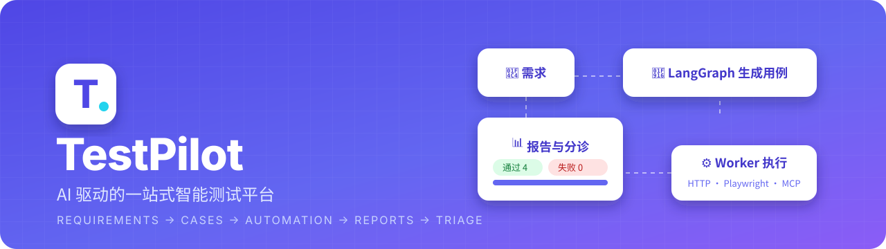
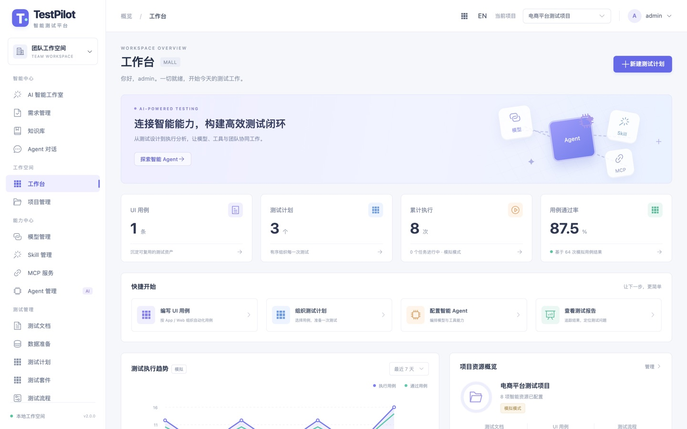
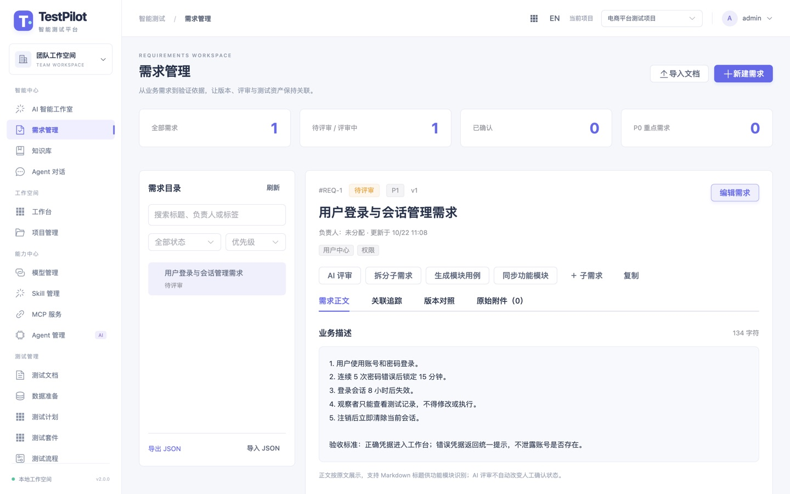
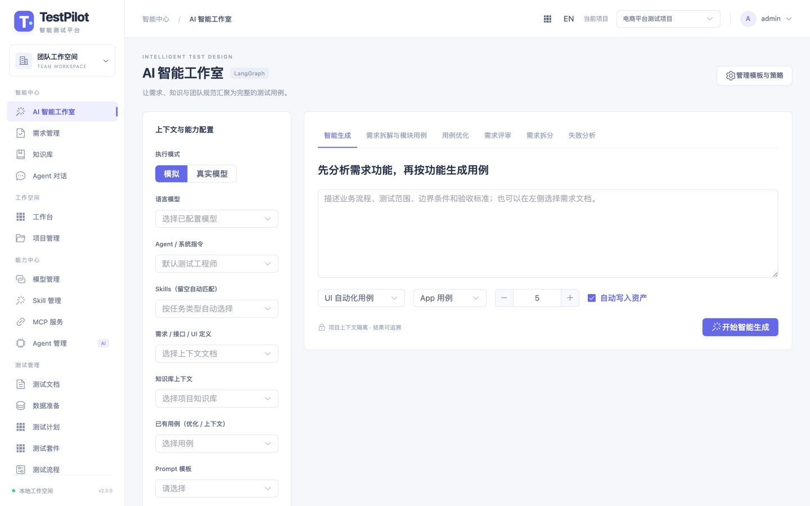
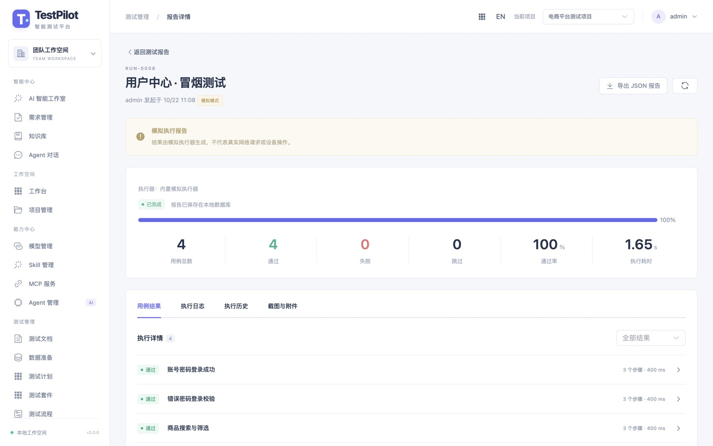
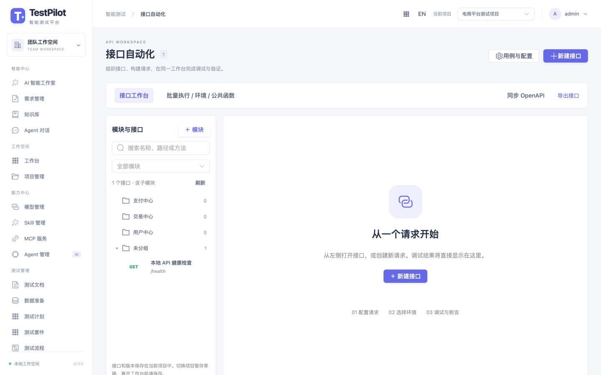
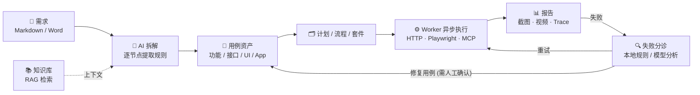
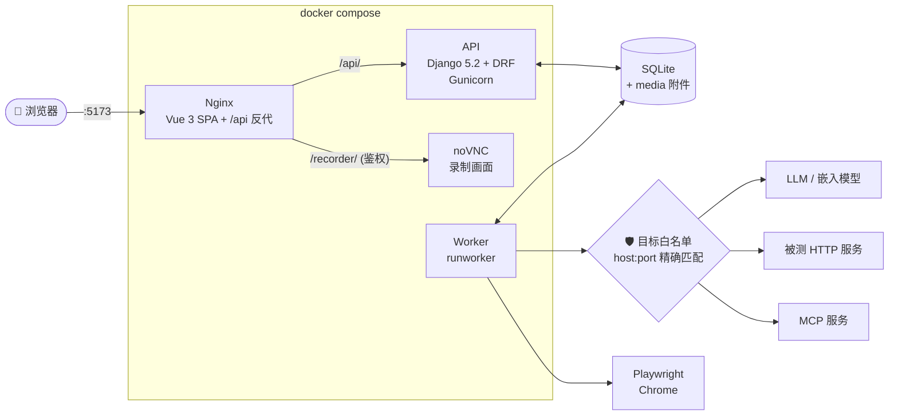
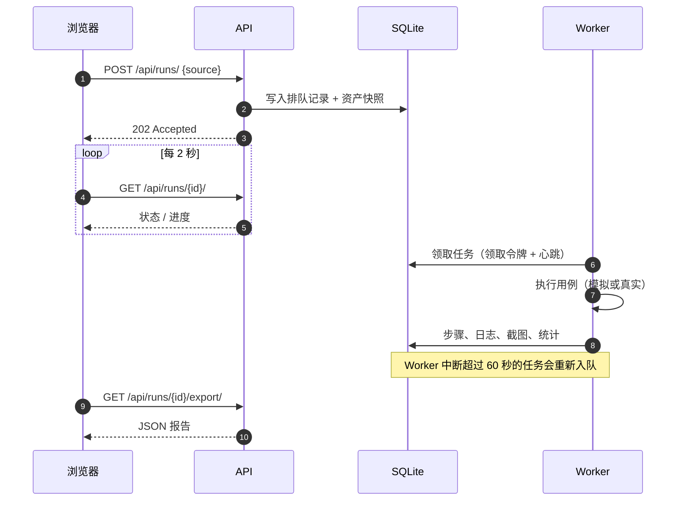

<p align="center">
  
</p>

<p align="center">
  
  
  
  
  
  
  
</p>

<p align="center">
  <b>从需求文档到测试报告，一条链路走完。</b><br>
  AI 拆需求、写用例 · 接口 / Web / App 自动化 · 异步执行 · 报告留痕 · 失败分诊与修复重试
</p>

<p align="center">
  <a href="#-快速开始">快速开始</a> ·
  <a href="#-功能一览">功能一览</a> ·
  <a href="#-架构">架构</a> ·
  <a href="docs/用户操作手册.md">用户操作手册</a> ·
  <a href="docs/功能详解.md">功能详解</a>
</p>

---

## ✨ 亮点

| | |
| --- | --- |
| 🧠 **AI 生成用例，不是一次性 Prompt** | LangGraph 编排「检索上下文 → 生成 → 覆盖检查 → 优化 → JSON 校验」，按需求逐节点拆解，再按六类维度生成单校验点用例，并记录覆盖缺口。 |
| 🔁 **测试闭环** | 需求 → 用例 → 计划 / 流程 → 执行 → 报告 → 失败分诊 → 修复后重试，全程可追溯。 |
| 🌐 **接口 + Web + App 三端自动化** | OpenAPI 同步与断言、平台内 Chromium 录制 / Playwright Trace、Android 真机（Mobile MCP）与录屏转用例。 |
| 🔌 **模型 / Skill / MCP / Agent 可插拔** | 兼容 OpenAI 协议的模型，声明式 Skill，远程 Streamable HTTP MCP，工具调用逐次审批。 |
| 🛡️ **默认安全** | 外呼目标精确白名单、凭据 Fernet 加密且不回传、日志脱敏、项目级 RBAC、全量审计。 |
| 🧪 **模拟模式开箱即用** | 不配置任何模型也能完整体验；所有模拟结果都会明确标注，不会冒充真实执行。 |

## 📸 截图

<table>
  <tr>
    <td width="50%"><p align="center"><sub>工作台：用例、计划、执行、通过率与七天趋势</sub></p></td>
    <td width="50%"><p align="center"><sub>需求管理：层级目录、版本对照、AI 评审与拆分</sub></p></td>
  </tr>
  <tr>
    <td width="50%"><p align="center"><sub>AI 智能工作室：模型、Agent、Skill、知识库组合生成用例</sub></p></td>
    <td width="50%"><p align="center"><sub>测试报告：进度、统计、逐用例结果、日志与附件</sub></p></td>
  </tr>
  <tr>
    <td colspan="2"><p align="center"><sub>接口自动化：模块树、多标签请求、断言与变量提取</sub></p></td>
  </tr>
</table>

## 🔁 测试闭环



## 🧩 功能一览

| 模块 | 能做什么 |
| --- | --- |
| **需求管理** | 层级目录、搜索筛选、验收标准、版本对照与恢复；导入 Markdown / Word；追踪需求 → 模块 → 用例 → 任务 |
| **AI 智能工作室** | 用例生成 / 优化、需求评审、需求拆分、失败分析；Prompt 模板与策略；Token 用量与完整任务追踪 |
| **知识库** | 文档分块、本地哈希向量或真实嵌入模型、可选 Reranker、按项目隔离检索并标注引用 |
| **测试用例** | 功能模块、等级、步骤 / 预期；列表与思维导图视图；拖拽归类；CSV / JSON 导入导出；测试套件 |
| **接口自动化** | OpenAPI 同步、环境 / Header / 变量、前后置函数、变量提取、HTTP 与数据库只读断言、批量执行 |
| **UI 自动化（Web）** | 平台内 Chromium 录制、导入 Playwright Trace、1–20 轮稳定性回放，每轮保存截图、WebM 视频、Trace |
| **UI 自动化（App）** | 通过 Mobile MCP 连接 Android 真机点选录制；或上传录屏，由视觉模型抽关键帧生成待复核用例 |
| **数据准备** | 生成 JSON 或 SQLite / MySQL / PostgreSQL INSERT；按示例或按范围随机，单次 1–1000 条 |
| **执行与报告** | 提交即返回 202，由独立 Worker 执行；可取消；报告保存资产快照，原用例改了也不影响历史报告 |
| **失败分诊与修复** | 本地规则分类（环境 / 鉴权 / 配置 / 断言差异）；模型给出可校验的修复后，由编辑者一键应用并重试 |
| **能力中心** | 模型、Skill、MCP、Agent 统一管理；Agent 可绑定同项目的模型与工具 |
| **治理** | 用户 / 组织 / 项目角色、30 天项目 API Key、深浅主题、中英文界面、操作审计与保留策略 |

> 每个模块的细节（限制、边界、回归命令）见 [docs/功能详解.md](docs/功能详解.md)。

## 🏗️ 架构



一次执行的生命周期：



## 🚀 快速开始

### 方式一：Docker Compose（推荐）

> 已在 Ubuntu 24.04 + Docker 29 + Compose v5 上验证：构建、启动、登录、提交执行、生成报告全流程跑通，容器内 148 个后端测试全部通过。

**1. 克隆并生成配置**

```bash
git clone https://github.com/juemengxin/TestPolit.git && cd TestPolit
cp backend/.env.example backend/.env

# 生成两个密钥，填到 backend/.env 的 DJANGO_SECRET_KEY 与 CREDENTIAL_KEY
python3 -c 'import secrets; print(secrets.token_urlsafe(64))'
python3 -c 'import base64, os; print(base64.urlsafe_b64encode(os.urandom(32)).decode())'
```

> ⚠️ 必须先创建 `backend/.env` 再启动。Compose 以文件方式挂载它，文件不存在时 Docker 会创建一个同名**目录**，导致启动失败。
>
> ⚠️ `CREDENTIAL_KEY` 用来加密已保存的模型 / MCP 凭据，丢失后这些凭据无法解密，请妥善备份。

**2. 构建并启动**

```bash
docker compose build api frontend
docker compose up -d --no-build --wait
docker compose ps        # frontend / api / worker 均为 healthy 或 Up
```

**3. 创建管理员，可选导入示例数据**

```bash
docker compose exec api python manage.py createsuperuser
docker compose exec api python manage.py seed_demo --username <管理员用户名>      # 电商示例项目 + 七天历史
docker compose exec api python manage.py seed_features --username <管理员用户名>  # 需求、知识库、接口/UI、模板、Skill 示例
```

**4. 打开浏览器**

访问 **http://127.0.0.1:5173**，登录后在顶部选择「电商平台测试项目」，进入「测试计划」并对一个**就绪**状态的计划点击执行，几秒后即可在「测试报告」中看到结果。

<details>
<summary><b>🧯 部署常见问题</b></summary>

| 现象 | 原因与处理 |
| --- | --- |
| `failed to resolve source metadata for docker.io/selenium/...` | 无法访问 Docker Hub 或镜像加速器失效。可换用可用的镜像加速器，或者临时把 `backend/Dockerfile` 第一行改为 `FROM docker.m.daocloud.io/selenium/standalone-chrome@sha256:...`（保留原 digest，内容完全一致）。 |
| PyPI / npm 下载慢 | `docker compose build --build-arg PIP_INDEX_URL=https://pypi.tuna.tsinghua.edu.cn/simple api`<br>`docker compose build --build-arg NPM_CONFIG_REGISTRY=https://registry.npmmirror.com frontend`<br>依赖版本仍然由锁文件固定。 |
| `port is already allocated`（8001 / 5173） | `TESTPILOT_BACKEND_PORT=18001 TESTPILOT_FRONTEND_PORT=5174 docker compose up -d`。改了前端端口后，需要把新地址加入 `.env` 的 `CSRF_TRUSTED_ORIGINS`，再重启 api。 |
| 部署在远程服务器，本机打不开 | 端口默认只绑定到服务器的 `127.0.0.1`。最简单的做法是 SSH 隧道：`ssh -L 5173:127.0.0.1:5173 user@server`，然后在本机访问 `http://127.0.0.1:5173`。若要直接对局域网开放，需要修改 `compose.yaml` 的端口绑定，同时更新 `DJANGO_ALLOWED_HOSTS` 和 `CSRF_TRUSTED_ORIGINS`。 |
| 登录后写操作 403 / CSRF 失败 | 浏览器地址必须出现在 `CSRF_TRUSTED_ORIGINS` 中；`localhost` 和 `127.0.0.1` 不要混用。 |
| 执行时提示「仅就绪的用例、计划或流程可以执行」 | 先把资产状态改为「就绪」。 |
| 一直处于排队状态 | `docker compose logs worker` 检查 Worker 是否已启动。 |
| 容器里访问宿主机的模型 / MCP | 地址写 `host.docker.internal:端口`，并把它原样加入 `TESTPILOT_ALLOWED_TARGETS`。 |

</details>

<details>
<summary><b>🔧 日常运维命令</b></summary>

```bash
docker compose logs --tail=100 frontend api worker   # 查看日志
docker compose exec api python manage.py check       # 自检
docker compose restart frontend api worker           # 重启
docker compose build frontend && docker compose up -d frontend   # 前端改动后更新
docker compose down                                  # 停止（数据保留）
```

- 数据都在宿主机 `./backend` 目录下：`db.sqlite3`、`media/`、`.env`、`.secret_key`。镜像中不包含这些文件，重建容器也不会删除它们。
- 备份：先 `docker compose stop`，再一起备份上述文件，最后 `docker compose start`。
- API 容器启动时会自动执行 `migrate`。

</details>

### 方式二：本地开发

需要 Python 3.11+ 和 Node.js 20.19+。

```bash
# 后端
python3 -m venv .venv && source .venv/bin/activate
pip install -r backend/requirements-lock.txt
cp backend/.env.example backend/.env       # 并按上文填写两个密钥
python backend/manage.py migrate
python backend/manage.py createsuperuser
python -m playwright install chromium      # 需要真实 UI 执行时安装
```

然后开三个终端：

```bash
python backend/manage.py runserver 127.0.0.1:8000   # ① API
python backend/manage.py runworker                  # ② Worker
cd frontend && npm ci && npm run dev                # ③ 前端（Vite 会把 /api 代理到 8000）
```

访问 http://127.0.0.1:5173 。如果想要 Vite 热更新、同时后端仍用 Docker 运行：`docker compose stop frontend`，再执行 `cd frontend && TESTPILOT_API_TARGET=http://127.0.0.1:8001 npm run dev`。

## ⚙️ 配置

`backend/.env` 常用项：

| 变量 | 说明 |
| --- | --- |
| `DJANGO_SECRET_KEY` | **必填**，随机长字符串 |
| `CREDENTIAL_KEY` | **必填**，Fernet 密钥，用于加密凭据；必须稳定保存 |
| `DJANGO_DEBUG` | 部署时设为 `false` |
| `DJANGO_ALLOWED_HOSTS` / `CSRF_TRUSTED_ORIGINS` | 实际访问的主机名 / 来源地址 |
| `SESSION_COOKIE_SECURE` | 使用 HTTPS 时设为 `true` |
| `TESTPILOT_ALLOWED_TARGETS` | 允许外呼的 `host:port` 列表，用逗号分隔，**不支持通配符**；模型、MCP 和被测系统都要列入 |
| `TESTPILOT_SECRET_<NAME>` | 服务端密钥，业务配置里用 `{{secret:NAME}}` 引用 |
| `TESTPILOT_BROWSER_CHANNEL` / `TESTPILOT_BROWSER_EXECUTABLE` | 本地运行时指定 Chrome；Docker 中已固定为镜像自带的 Chrome |
| `TESTPILOT_GEMINI_PROXY` | 仅供 Gemini 使用的本机 HTTP 代理（只接受 localhost / 127.0.0.1） |

接入真实模型：进入「模型管理」，填写 OpenAI 兼容的 Base URL、模型名和密钥，再把该主机加入 `TESTPILOT_ALLOWED_TARGETS` 并重启 Worker；连接测试通过后即可切换到「真实模型」模式。

## 👥 角色与权限

| 角色 | 权限 |
| --- | --- |
| 系统超级管理员 | 所有项目的全部权限 |
| 项目所有者 | 管理项目和成员，执行全部业务操作，审批 MCP 工具调用 |
| 编辑者 | 维护配置、资产和附件，执行及取消任务，删除已结束的报告 |
| 观察者 | 查看数据、下载附件、导出报告 |

所有权限都在后端校验，不依赖前端是否隐藏按钮。添加成员的路径是「项目管理 → 成员」；也可以用命令行建号：`python manage.py createuser <用户名>`。

## 🛡️ 安全设计

- **外呼白名单**：真实的 HTTP、AI、MCP 和浏览器请求都按 `host:port` 精确匹配，禁止重定向、环境代理以及浏览器的 Service Worker / WebSocket。
- **凭据**：只能写入 `secret` 字段，Fernet 加密存储，API 只返回 `has_secret`；服务地址中不允许出现账号、密码或查询参数。
- **脱敏**：Authorization、Cookie 和常见 Token 字段在结果与日志中自动打码。
- **不执行任意代码**：接口前后置只支持 `set / uuid / timestamp / concat`；UI 只支持白名单步骤；Skill 只是声明式指令。
- **MCP 审批**：真实工具调用会记录工具名和参数，由项目所有者逐次审批。
- **附件**：按扩展名白名单和大小校验，随机文件名存储，强制以下载方式返回并带 `nosniff`，不开放 `/media/` 静态路由。

> 适用范围：SQLite + 单 Worker 适合本地或小团队使用。需要大规模并发时，建议迁移到 PostgreSQL 和外部任务队列。当前版本不包含定时调度与分布式执行节点。

## 🔗 API

所有写操作需要 Session Cookie 和 CSRF Token：先 `GET /api/auth/session/` 获取 `csrftoken`，后续请求在 `X-CSRFToken` 头中带上它（登录后 Token 会轮换，需要重新读取）。

<details>
<summary><b>展开端点列表</b></summary>

| 端点 | 功能 |
| --- | --- |
| GET `/api/auth/session/` | 获取当前用户，并初始化 CSRF |
| POST `/api/auth/login/` · `/api/auth/logout/` | 登录 / 注销 |
| `/api/projects/`、`/{id}/` | 项目 CRUD |
| GET `/api/projects/{id}/overview/` | 工作台统计与趋势 |
| GET/POST/DELETE `/api/projects/{id}/members/` | 成员管理 |
| `/api/resources/`、`/{id}/` | 模型 / Skill / MCP / Agent |
| `/api/assets/`、`/{id}/` · GET `/api/assets/export/` | 文档 / 用例 / 计划 / 流程，导出 CSV |
| POST `/api/runs/` | `{"source": 资产ID}` → **202** |
| GET `/api/runs/`、`/{id}/` · POST `/{id}/cancel/` · GET `/{id}/export/` | 报告查询、取消、JSON 导出 |
| `/api/attachments/` · GET `/{id}/download/` | 附件上传 / 列表 / 下载 / 删除 |
| `/api/entities/` · `/{id}/revisions/` · `/{id}/restore/` · `/{id}/search/` | 版本化实体（需求、知识库、模板、接口 / UI 配置等） |
| POST `/api/entities/sync_openapi/` · `/api/entities/prepare_data/` | OpenAPI 同步、数据准备 |
| POST `/api/artifacts/` | 上传文档，触发后台解析 |
| `/api/jobs/` · POST `/{id}/approve/` · POST `/{id}/apply/` | 统一任务、MCP 审批、写入生成结果 |
| `/api/preferences/` · `/api/access-keys/` | 个人偏好、项目 API Key |
| `/api/system/users/`、`organizations/`、`config/`、`audit/` | 系统治理 |

列表接口支持 `project`、`search`、`page`（每页 10 条）、`kind`、`status`，返回格式为 `{count, next, previous, results}`。

</details>

## 🧪 测试

```bash
# 后端单元 / 接口测试（使用临时数据库，不影响工作数据）
python backend/manage.py test workbench
# 或者在容器里执行：
docker compose exec api python manage.py test workbench --noinput

python backend/manage.py makemigrations --check --dry-run
node --test frontend/tests/*.test.mjs
cd frontend && npm run build
```

集成测试会向本地协议靶场发送真实请求，覆盖 HTTP 断言、OpenAI 兼容协议、嵌入、MCP、Playwright 产物。靶场只监听 `127.0.0.1:8766`，不是真实模型：

```bash
python scripts/fixture_server.py
TESTPILOT_INTEGRATION=1 python backend/manage.py test workbench.test_adapters
```

## 📚 文档

- [用户操作手册](docs/用户操作手册.md)：面向测试人员与管理员的完整操作说明
- [功能详解](docs/功能详解.md)：需求工作台、接口工作台、数据准备、MCP、失败分诊等模块的细节与边界

## 📁 目录结构

```text
TestPolit/
├── backend/              # Django 项目（config/ 配置，workbench/ 业务应用）
│   ├── Dockerfile
│   ├── .env.example
│   └── requirements-lock.txt
├── frontend/             # Vue 3 + Vite + Element Plus，Nginx 镜像
├── docker/               # 容器入口脚本
├── scripts/              # 协议测试靶场、Mobile MCP 启动脚本
├── skills/               # 示例 Skill（SKILL.md）
├── docs/                 # 用户手册、功能详解、README 图片
└── compose.yaml
```
